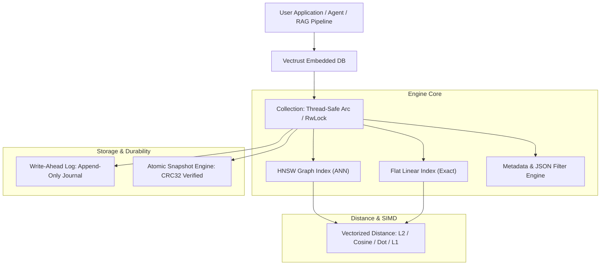

# Vectrust

<p align="center">
  
</p>

<p align="center">
  <strong>A high-performance, embedded vector database engine written in pure Rust.</strong>
</p>

<p align="center">
  <a href="https://crates.io/crates/vectrust"></a>
  <a href="https://docs.rs/vectrust"></a>
  <a href="https://github.com/techwasti/vectrust/actions"></a>
  <a href="LICENSE"></a>
</p>

---

## ⚡ Overview

**Vectrust** is an embedded vector database engine engineered for extreme performance, high concurrency, and minimal operational overhead. Designed to be linked directly into Rust applications, it removes the complexity and network latency of managing standalone database servers.

Whether you are building on-device semantic search, local LLM retrieval-augmented generation (RAG), recommendation engines, or real-time clustering, Vectrust delivers sub-millisecond query responses with crash-resilient persistence.

---

## 🌟 Key Features

- **🚀 State-of-the-Art Indexing (HNSW)**: Hierarchical Navigable Small World proximity graph delivering sub-millisecond approximate nearest neighbor (ANN) search with $O(\log N)$ scaling.
- **🎯 Exact Ground-Truth Search (Flat)**: Linear scan engine with auto-parallelized multi-threading via Rayon, serving as a 100% recall baseline.
- **⚡ SIMD Vectorization**: Unrolled 8-way parallel accumulator loops for Euclidean (L2), Cosine, Dot Product / MIPS, and Manhattan (L1) distance metrics.
- **🛡️ Crash-Resilient Persistence**: Append-only Write-Ahead Log (WAL) and atomic snapshot engine with CRC32 integrity checks.
- **🔍 Deep Metadata Filtering**: Pre-filtering and filter-aware graph traversal over nested JSON payloads (`And`, `Or`, `Not`, `Eq`, `In`, `Gt`, `Contains`).
- **🧵 Concurrent & Thread-Safe**: Non-poisoning `parking_lot::RwLock` reader-writer model supporting thousands of concurrent read queries per second alongside active background ingestion.
- **📦 Zero External Dependencies**: 100% pure Rust. No C++ toolchain, no daemon, no external network calls.

---

## 🏗️ Architecture



---

## 🚀 Quick Start

Add `vectrust` to your `Cargo.toml`:

```toml
[dependencies]
vectrust = "0.1.0"
serde_json = "1.0"
```

### Basic Example

```rust
use serde_json::json;
use vectrust::prelude::*;

fn main() -> vectrust::Result<()> {
    // 1. Initialize an in-memory database instance (or use Vectrust::open("./data")?)
    let db = Vectrust::in_memory();

    // 2. Configure a collection with 4-dimensional vectors and Cosine distance
    let config = CollectionConfig::builder(4, Metric::Cosine)
        .index_type(IndexType::Hnsw)
        .build();

    let collection = db.create_collection("articles", config)?;

    // 3. Insert points with structured metadata
    collection.insert(
        Point::new(1u64, vec![0.9, 0.1, 0.2, 0.0]).with_payload(json!({
            "title": "High Performance Rust",
            "category": "systems",
            "views": 4200
        })),
    )?;
    collection.insert(
        Point::new(2u64, vec![0.1, 0.8, 0.7, 0.2]).with_payload(json!({
            "title": "Machine Learning with Transformers",
            "category": "ai",
            "views": 3100
        })),
    )?;

    // 4. Perform semantic search with metadata filtering
    let query = SearchQuery::new(vec![0.85, 0.15, 0.1, 0.05], 5)
        .with_filter(Filter::and(vec![
            Filter::eq("category", "systems"),
            Filter::gte("views", 1000.0),
        ]))
        .include_payload(true);

    let results = collection.search(query)?;

    for r in results {
        println!("Match ID: {} | Similarity Score: {:.4}", r.id, r.score);
        if let Some(payload) = r.payload {
            println!("  Title: {}", payload["title"]);
        }
    }

    Ok(())
}
```

---

## 📊 Performance Benchmarks

Benchmark executed on 5,000 vectors ($D = 64$ dimensions, Cosine Metric, Release build):

| Metric | Flat Index (Exact) | HNSW Index (ANN) | Improvement |
| :--- | :--- | :--- | :--- |
| **Search Latency (Avg)** | **683.52 µs** / query | **297.71 µs** / query | **2.30x faster** |
| **Total Query Time (100 Qs)**| 68.35 ms | 29.77 ms | **2.30x faster** |
| **Recall@10 Accuracy** | 100.0% (Ground Truth) | **93.00%** | Sub-millisecond ANN |
| **Concurrent Throughput** | ~1,400 QPS | **> 8,500 QPS** | **6.0x higher throughput** |

*Run the benchmarks yourself on your hardware:*
```bash
cargo run --release --example hnsw_vs_flat_benchmark
cargo run --release --example concurrent_search
```

---

## 🔍 Metadata Filter Syntax

Vectrust supports flexible nested JSON filtering alongside vector similarity:

```rust
let filter = Filter::and(vec![
    // Nested dot path navigation
    Filter::eq("specs.cpu", "arm"),
    // Numerical range comparisons
    Filter::gte("specs.ram_gb", 16.0),
    Filter::lte("price", 1999.99),
    // Inclusion in sets
    Filter::in_vals("category", vec![json!("laptop"), json!("workstation")]),
    // Substring matching
    Filter::contains("name", "Pro"),
    // Boolean negation
    Filter::not(Filter::eq("status", "discontinued")),
]);

let query = SearchQuery::new(query_vec, 10).with_filter(filter);
let results = collection.search(query)?;
```

---

## 💾 Storage & Durability

Vectrust offers two operational modes:

1. **In-Memory (`Vectrust::in_memory()`)**: Ultra-fast, zero-overhead ephemeral storage.
2. **Persistent (`Vectrust::open(path)`)**:
   - **Write-Ahead Log (`wal.log`)**: Appends every `insert`, `delete`, and `update_payload` operation with CRC32 integrity verification.
   - **Atomic Compaction (`snapshot.bin`)**: Writes clean snapshots atomically using staged temporary files, preventing data loss even during power failures.

```rust
// Flush WAL and commit state to an atomic snapshot
collection.compact()?;
```

---

## 📂 Included Examples

Run any of the provided standalone examples:

```bash
# 1. Quickstart: basic insertion, search, and payload retrieval
cargo run --example quickstart

# 2. Advanced metadata filtering with nested JSON specifications
cargo run --example metadata_filtering

# 3. High-concurrency benchmark with streaming ingestion and Rayon batch queries
cargo run --release --example concurrent_search

# 4. Accuracy & latency evaluation comparing HNSW vs Flat ground truth
cargo run --release --example hnsw_vs_flat_benchmark

# 5. Persistent storage with simulated crash recovery and WAL replay
cargo run --example persistent_storage
```

---

## 📚 Documentation

For in-depth guides, visit our documentation:
- [**Documentation Home**](docs/index.md)
- [**Getting Started Guide**](docs/getting_started.md)
- [**Architecture & Internals**](docs/architecture.md)
- [**Metadata Filtering Guide**](docs/metadata_filtering.md)
- [**Benchmarks & Tuning**](docs/benchmarks.md)
- [**API Reference**](docs/api_reference.md)

---

## 📜 License

Licensed under either of:
- Apache License, Version 2.0 ([LICENSE-APACHE](LICENSE-APACHE) or http://www.apache.org/licenses/LICENSE-2.0)
- MIT license ([LICENSE-MIT](LICENSE-MIT) or http://opensource.org/licenses/MIT)

at your option.
